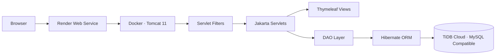

# Employee & Project Management System

<p align="center">
  <a href="https://employee-management-system-wavl.onrender.com/login">
    
  </a>
  
  
  
  
</p>

A server-rendered Java web application for managing employees, projects, team allocations, and project tasks. The application uses Jakarta Servlets for request handling, Thymeleaf for server-side views, Hibernate ORM for persistence, and BCrypt for password hashing.

**Live demo:** [employee-management-system-wavl.onrender.com/login](https://employee-management-system-wavl.onrender.com/login)  
**Source code:** [github.com/ayushshekhar018/employee-management-system](https://github.com/ayushshekhar018/employee-management-system)

> **Deployment status:** The Render deployment is live and its `/login` health check has succeeded. The login page has been opened successfully in a browser. Database-backed login and CRUD workflows still need an end-to-end verification; a successful web health check alone does not prove that the hosted database connection works.

---

## Product overview

The Employee & Project Management System provides a single web interface for maintaining employee records, organizing projects, allocating people to project teams, and tracking work through a task board.

### What it can do

- **Authentication and roles** — session-based sign-in and sign-out, BCrypt password verification, and route-level access checks for authenticated users and administrators.
- **Employee management** — create, view, edit, and delete employee records containing department, designation, email, salary, and role information.
- **Project management** — maintain project details such as client, start date, budget, status, and maximum team size.
- **Team allocation** — allocate employees to projects, review multi-project allocations before confirmation, and report project-specific successes or validation failures.
- **Task management** — create project tasks, optionally assign an employee, set priority and due date, and track task status.
- **Employee project views** — view the projects associated with an employee and show employees assigned to a project.

---

## Technology

The versions below reflect the dependencies and build configuration in [pom.xml](pom.xml).

**Application and build**
- Java 17 language target
- Apache Maven
- WAR packaging
- Jakarta Servlet API 6.1
- Apache Tomcat 11
- Docker for the hosted runtime

**Persistence and presentation**
- Hibernate ORM 7.4.11.Final
- MySQL Connector/J 26.10.0
- MySQL-compatible TiDB Cloud database for the hosted demo
- Thymeleaf 3.1.5.RELEASE
- jBCrypt 0.4

**Testing**
- JUnit Jupiter 6.1.3
- H2 2.5.252 (test scope)

The Servlet API dependency uses Maven's `provided` scope because the servlet container supplies it at runtime.

---

## Architecture

The application follows a layered, servlet-based MVC design.



**Request and persistence flow**

1. A browser sends an HTTP request to the Render-hosted application.
2. Servlet filters handle request logging and authentication/authorization checks.
3. Servlets validate request parameters and coordinate application workflows.
4. Thymeleaf renders server-side HTML templates.
5. DAO classes execute data-access operations through Hibernate sessions and transactions.
6. Hibernate maps the Employee, Project, and Task entities to the relational database.

### Source layout

```text
employee-management-system/
├── pom.xml
├── src/
│   ├── main/
│   │   ├── java/com/employeemanagement/
│   │   │   ├── config/       # Thymeleaf application configuration
│   │   │   ├── dao/          # Data-access objects
│   │   │   ├── filter/       # Authentication and request logging
│   │   │   ├── model/        # Hibernate entities
│   │   │   ├── servlet/      # HTTP request handlers
│   │   │   └── util/         # Hibernate and password utilities
│   │   ├── resources/
│   │   │   └── hibernate.cfg.xml
│   │   └── webapp/
│   │       ├── WEB-INF/
│   │       │   ├── templates/  # Thymeleaf HTML templates
│   │       │   └── web.xml
│   │       ├── css/
│   │       └── index.jsp
│   └── test/
│       ├── java/              # Automated tests
│       └── resources/         # Test Hibernate configuration
└── README.md
```

The Render-specific deployment files are maintained in the [deploy/render-tidb branch](https://github.com/ayushshekhar018/employee-management-system/tree/deploy/render-tidb), keeping the default `master` branch focused on the application source.

---

## Live deployment

The public demo runs on the following services:

**Application hosting — Render**
- Service: [employee-management-system](https://dashboard.render.com/)
- Public URL: [https://employee-management-system-wavl.onrender.com/login](https://employee-management-system-wavl.onrender.com/login)
- Runtime: Docker image containing Apache Tomcat 11
- Region: Singapore
- Compute plan: Free
- Health check: `/login`
- Deployment branch: `deploy/render-tidb`

**Database hosting — TiDB Cloud Starter**
- Cluster compatibility: MySQL
- Cloud region: AWS Singapore (`ap-southeast-1`)
- Database/schema: `employeedb`
- MySQL-compatible port: `4000`
- TLS mode: `VERIFY_IDENTITY`

Database credentials are stored in Render's environment settings. They are not included in this repository.

### Deployment files

The [deployment branch](https://github.com/ayushshekhar018/employee-management-system/tree/deploy/render-tidb) contains the files used by Render:

- [Dockerfile](https://github.com/ayushshekhar018/employee-management-system/blob/deploy/render-tidb/Dockerfile) — builds the WAR with Maven and runs it on Tomcat 11.
- [docker-entrypoint.sh](https://github.com/ayushshekhar018/employee-management-system/blob/deploy/render-tidb/docker-entrypoint.sh) — configures Tomcat to listen on Render's `PORT`.
- [.dockerignore](https://github.com/ayushshekhar018/employee-management-system/blob/deploy/render-tidb/.dockerignore) — excludes local IDE metadata and generated files from the Docker build context.
- [render.yaml](https://github.com/ayushshekhar018/employee-management-system/blob/deploy/render-tidb/render.yaml) — declares the Render web service, region, plan, health check, and environment variables.
- [HibernateUtil.java](https://github.com/ayushshekhar018/employee-management-system/blob/deploy/render-tidb/src/main/java/com/employeemanagement/util/HibernateUtil.java) — uses environment-provided database settings when `DB_HOST` is set.

### Render environment variables

Configure these values in the Render service's **Environment** page. Never commit real credentials to GitHub.

- `DB_HOST` — TiDB endpoint hostname (hostname only; do not include the JDBC scheme).
- `DB_PORT` — `4000`.
- `DB_NAME` — `employeedb`.
- `DB_USERNAME` — TiDB database username.
- `DB_PASSWORD` — TiDB database password; store it as a secret.
- `DB_SSL_MODE` — `VERIFY_IDENTITY`.

When `DB_HOST` is absent, the application uses the local connection settings in `src/main/resources/hibernate.cfg.xml`. When `DB_HOST` is present, `DB_NAME`, `DB_USERNAME`, and `DB_PASSWORD` are required. The application uses port `4000` and TLS mode `VERIFY_IDENTITY` by default.

### Deployment behaviour and free-tier limits

This setup is intended for a portfolio demonstration and learning environment, not a production service.

- Render Free web services spin down after 15 minutes without inbound traffic. A sleeping service can take about a minute to respond to the next request.
- Render Free services have an ephemeral filesystem. Files written inside the container are not durable across restarts, redeploys, or spin-downs. Persistent application records belong in TiDB.
- Render provides 750 free instance-hours per workspace per calendar month; the allowance is shared by the workspace's Free services.
- TiDB Cloud Starter's published free quota for eligible instances is 5 GiB row storage, 5 GiB columnar storage, and 50 million Request Units per month. Usage is subject to provider limits and policy changes.

Check the providers' live documentation before relying on free-tier capacity or availability.

---

## Run locally

### Prerequisites

- JDK 17
- Apache Maven 3.8 or later
- MySQL Server 8.0 or a compatible MySQL database
- Apache Tomcat 11.x (or another Servlet 6.1-compatible container)
- An IDE such as IntelliJ IDEA (optional)

Verify your local tools:

~~~bash
java -version
mvn -version
mysql --version
~~~

### 1. Clone the repository

~~~bash
git clone https://github.com/ayushshekhar018/employee-management-system.git
cd employee-management-system
~~~

### 2. Create the database

Connect to your local MySQL instance and run:

~~~sql
CREATE DATABASE employeedb;
~~~

### 3. Configure the local database connection

Open `src/main/resources/hibernate.cfg.xml` and set the connection URL, username, and password for your local MySQL installation.

~~~xml
<property name="hibernate.connection.url">jdbc:mysql://localhost:3306/employeedb?useSSL=false&amp;allowPublicKeyRetrieval=true&amp;serverTimezone=UTC</property>
<property name="hibernate.connection.username">YOUR_MYSQL_USERNAME</property>
<property name="hibernate.connection.password">YOUR_MYSQL_PASSWORD</property>
~~~

Use a dedicated database user where possible. Do not commit local or production credentials.

### 4. Build the WAR

Run from the repository root:

~~~bash
mvn clean package
~~~

The generated artifact is:

~~~text
target/employee-management-system.war
~~~

### 5. Run on Tomcat

Copy the WAR into Tomcat's `webapps` directory and start the server:

~~~bash
cp target/employee-management-system.war "$CATALINA_HOME/webapps/"
"$CATALINA_HOME/bin/startup.sh"
~~~

On Windows, use the corresponding `.bat` scripts under Tomcat's `bin` directory.

With the default WAR filename, open:

~~~text
http://localhost:8080/employee-management-system/
~~~

Tomcat 11 implements Jakarta Servlet 6.1. Do not deploy this application to a container that only supports the older `javax.servlet` namespace.

---

## Tests

Run the automated test suite with:

~~~bash
mvn test
~~~

JUnit Jupiter and H2 are declared in test scope. Tests should use the configuration under `src/test/resources` and should not depend on the hosted TiDB instance.

---

## Database initialization and first login

The application does not currently seed a default administrator account or publish demo credentials.

The deployment branch initializes Hibernate lazily on the first data-access operation. This keeps the login page and Render health check independent of database availability. Consequently, a successful `/login` health check confirms that the web application responds; it does **not** by itself confirm database authentication or CRUD functionality.

The Hibernate configuration currently uses `hibernate.hbm2ddl.auto=update`, so mapped tables are created or updated when Hibernate first initializes successfully. Before using the live demo, verify database connectivity and create an administrator account with a BCrypt hash generated by the project's `PasswordUtil.hash()` method. Never store a plain-text password in the password column.

---

## Security and production considerations

Before using this application with real organizational data:

- Keep database credentials in environment-backed secrets or a secrets manager.
- Use a dedicated database account with only the privileges the application requires.
- Enforce TLS for database connections and HTTPS for browser traffic.
- Add CSRF protection to state-changing form submissions.
- Review session lifecycle, role checks, and authorization for every write operation.
- Validate all user-submitted values on the server.
- Replace schema auto-update with a controlled database migration process.
- Disable or appropriately configure SQL logging.
- Establish database backups and test restoration.
- Do not rely on free-tier hosting for production availability or critical records.

---

## Official documentation and references

The following primary sources describe the platform behaviour and core technologies used by this project:

**Hosting and deployment**
- [Render — Web Services](https://render.com/docs/web-services)
- [Render — Docker deployments](https://render.com/docs/docker)
- [Render — Environment Variables and Secrets](https://render.com/docs/configure-environment-variables)
- [Render — Free instance limitations](https://render.com/docs/free)
- [Render — Deploys and manual deploys](https://render.com/docs/deploys)

**Database and connectivity**
- [TiDB Cloud Starter — FAQs and free quota](https://docs.pingcap.com/tidbcloud/serverless-faqs/?plan=starter)
- [TiDB Cloud Starter — Select a cluster tier](https://docs.pingcap.com/tidbcloud/select-cluster-tier/)
- [TiDB Cloud — Quick Start](https://docs.pingcap.com/tidbcloud/get-started/)
- [MySQL Connector/J — Security properties and SSL modes](https://dev.mysql.com/doc/connector-j/en/connector-j-connp-props-security.html)

**Java web stack**
- [Apache Tomcat 11 documentation](https://tomcat.apache.org/tomcat-11.0-doc/)
- [Jakarta Servlet 6.1 specification](https://jakarta.ee/specifications/servlet/6.1/)
- [Java SE 17 documentation](https://docs.oracle.com/en/java/javase/17/)
- [Apache Maven documentation](https://maven.apache.org/guides/)
- [Hibernate ORM documentation](https://hibernate.org/orm/documentation/)
- [Thymeleaf documentation](https://www.thymeleaf.org/documentation.html)

---

## Author

**Ayush Shekhar**  
[GitHub: @ayushshekhar018](https://github.com/ayushshekhar018)

Feedback, bug reports, and constructive suggestions are welcome through the repository's [Issues](https://github.com/ayushshekhar018/employee-management-system/issues).
